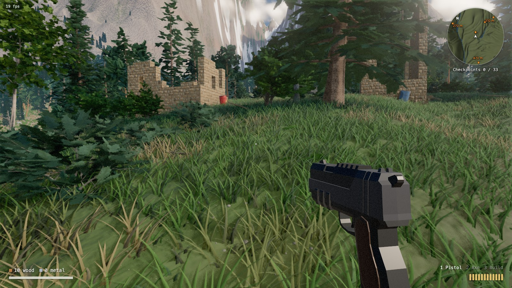

# E&S

*Explore & Survive* is a first-person survival shooter set in a procedural 4×4 km world that runs in the browser on WebGPU.



**[Play it here](https://tamlyn.github.io/explore-and-survive/)** in desktop Chrome. Nothing else will run it.

You start in a forest with a pistol, an axe and enough wood for a small shelter. Ruined stone settlements are scattered across the valleys, each with a beacon and a few robots guarding it. Touch a beacon and that's where you come back after dying. The radar points you towards the ones you haven't found yet.

Fell trees with the axe for wood, then build walls, floors and ramps out of it, Fortnite style. Robots aren't fooled by a wall — they know you're behind it and shoot it down. Wrecked robots drop scrap metal, which will one day buy vehicles. Health only comes back part of the way on its own, so you'll want the medkits in the wooden crates.

## Controls

Click to capture the mouse. WASD moves, Shift sprints and Space jumps. 1, 2 and 3 (or the wheel) pick the pistol, axe or build tool, and left click uses whatever's in hand. R reloads, or picks the next piece to build. H shows the full list, including V for free-fly and the debug views.

## Running it

```
npm install
npm run dev
```

Then open `http://localhost:5173` in Google Chrome 113 or newer. There's no WebGL fallback, and the page tells you if your browser can't cope.

Every push to `main` deploys to GitHub Pages.

## Where it came from

E&S is a fork of [LAAS](https://github.com/Braffolk/fable5-world-demo), a procedural world demo by Remi Sebastian Kits that was built almost entirely by Claude Fable 5. The terrain, forests, rivers, sky and lighting are all LAAS. The game on top is being built the same way, with Claude Code doing the typing and me doing the steering.


Unlike LAAS, which generates everything at boot, E&S uses a few CC0 models and textures from [Quaternius](https://quaternius.com) and [Poly Haven](https://polyhaven.com). They're credited in [assets/models/CREDITS.md](assets/models/CREDITS.md) and [assets/textures/CREDITS.md](assets/textures/CREDITS.md).

The LAAS brief and the model's working notes are still here in [PROJECT_LAAS_v2.md](PROJECT_LAAS_v2.md) and [STATUS.md](STATUS.md), if you want to see how the world was made.
